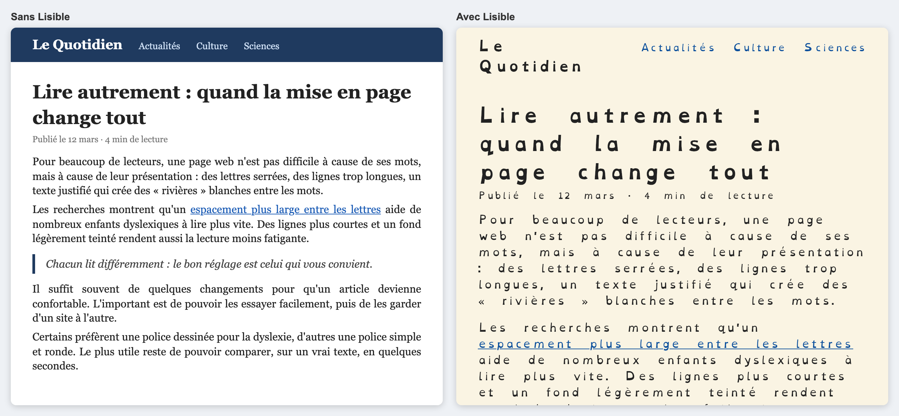
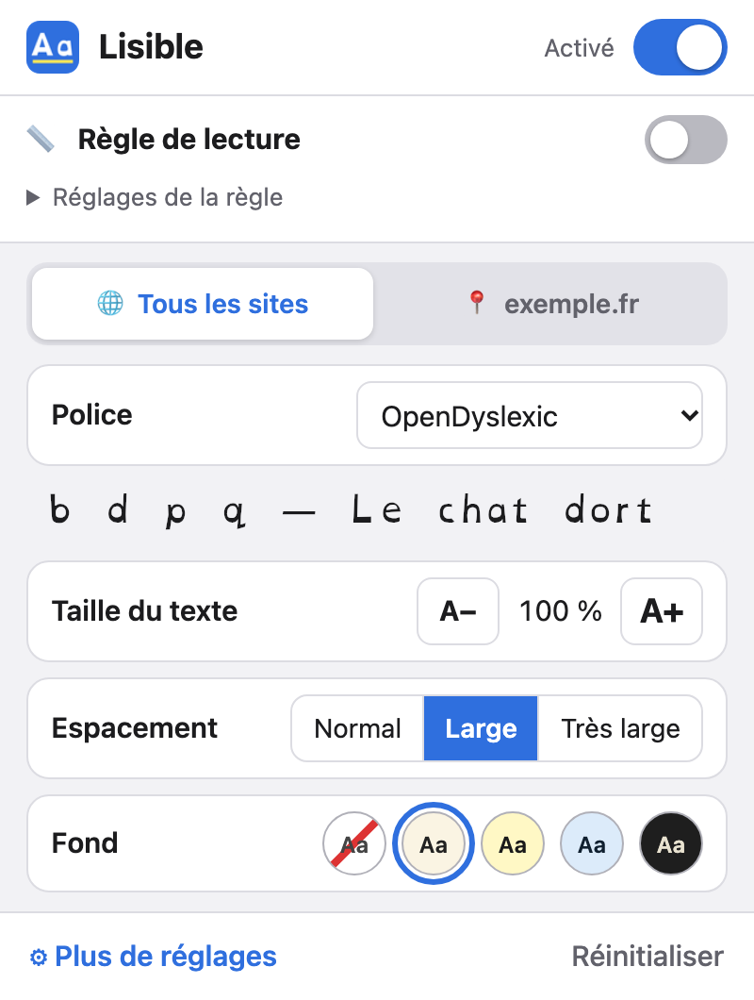
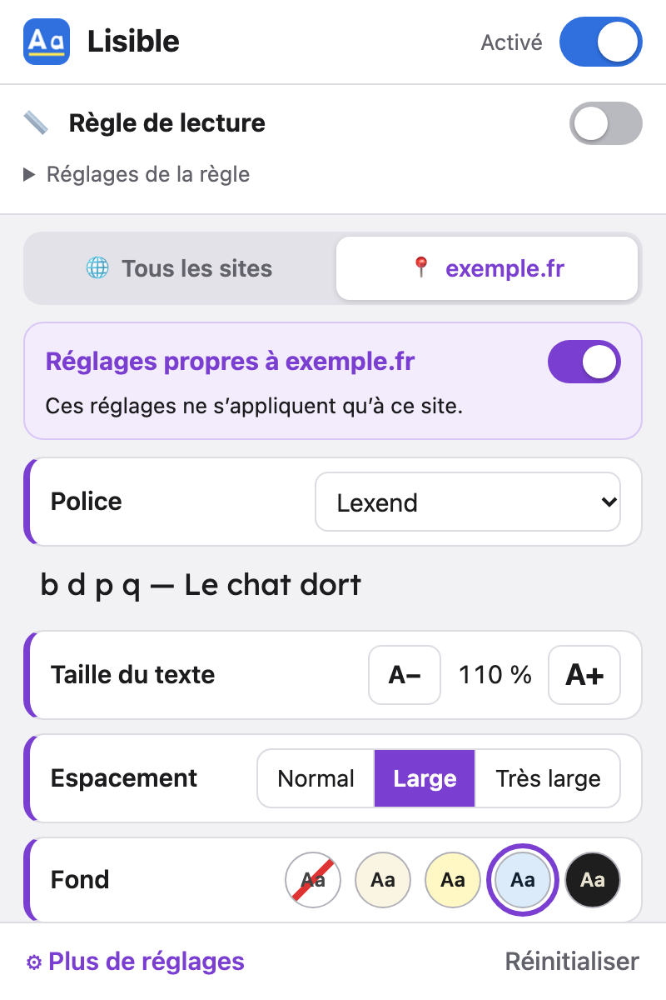
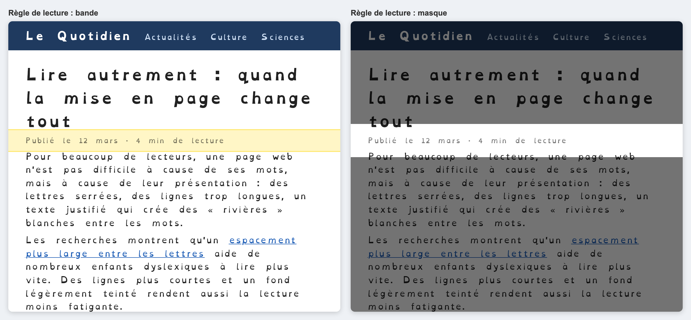

# Lisible

*[English](README.md) · Français*

Extension de navigateur pour **Safari, Chrome, Edge et Firefox**, sur **ordinateur, tablette et téléphone**, qui rend le web plus confortable à lire pour les personnes dyslexiques : police adaptée, espacements, couleurs, règle de lecture, avec des réglages communs à tous les sites et des exceptions par site.


 
## Compatibilité

| Appareil | Navigateurs | Build |
|---|---|---|
| Ordinateur (macOS, Windows, Linux) | Chrome, Edge et autres navigateurs Chromium | `dist/chrome` |
| | Firefox | `dist/firefox` |
| Mac | Safari | projet Xcode |
| Téléphone et tablette Android | Firefox pour Android | `dist/firefox` |
| iPhone et iPad | Safari | projet Xcode |

Sur iPhone et iPad, seul Safari accepte les extensions. Sur Android, Chrome n'en accepte pas : il faut Firefox.

Le build Chrome est testé automatiquement dans Chromium, et le build Firefox est validé par l'outil officiel de Mozilla (`web-ext lint`). Edge, Firefox pour Android et Safari n'ont pas encore été essayés sur un vrai appareil.

## Documentation

- [Manuel utilisateur](docs/fr/manuel-utilisateur.md) : installer, activer et régler Lisible.
- [Manuel développeur](docs/fr/manuel-developpeur.md) : architecture, ajout d'un réglage ou d'une police, tests, compilation et publication.

## Fonctionnalités

<p>
  
  
</p>



| | |
|---|---|
| **Polices incluses** | OpenDyslexic, Atkinson Hyperlegible, Lexend, Andika (licence SIL OFL, fichiers embarqués qui fonctionnent hors ligne) |
| **Polices système** | Verdana, Arial, ou la police d'origine du site |
| **Texte** | taille (80–200 %), épaisseur des lettres (normale / grasse), alignement (gauche / centré / droite / justifié), casse (minuscules / MAJUSCULES / Première Lettre), suppression de l'italique |
| **Espacements** | entre les lettres, entre les mots, interligne, entre les paragraphes, largeur maximale des lignes (en caractères) |
| **Préréglage recommandé** | en un clic : lettres +0,12 em, mots +0,42 em, interligne 1,5, lignes de 70 caractères, fond crème, sans italique. Ce sont des valeurs approchées du guide de la British Dyslexia Association ; la police choisie est conservée |
| **Couleurs** | thèmes crème, jaune, bleu, vert, rose, gris et sombre, ou couleurs personnalisées (texte, fond, liens) |
| **Liens** | surlignage (couleur au choix, texte noir ou blanc selon le contraste), encadrement |
| **Règle de lecture** | une bande colorée, ou un masque qui assombrit le reste de la page ; elle suit le pointeur, ou le doigt sur téléphone et tablette. Commune à tous les sites, en haut de la popup |
| **Par site** | onglet du site (en violet) dans la popup : désactiver Lisible sur ce site ou lui donner ses propres réglages ; liste de tous les sites particuliers dans « Plus de réglages » |
| **Deux niveaux** | popup simple (police, taille, espacement Normal / Large / Très large, fond) et page « Plus de réglages » pour tous les réglages fins |
| **Annuler** | chaque changement fait dans la popup peut être annulé |
| **Aperçu** | texte d'exemple qui applique les réglages en direct (dans « Plus de réglages » ; dans la popup, c'est la page elle-même qui sert d'aperçu) |
| **Raccourcis (ordinateur)** | `Alt+Maj+D` (`⌥⇧D` sur Mac) active ou désactive Lisible sur le site, `Alt+Maj+R` (`⌥⇧R`) affiche ou masque la règle |
| **Langues** | français et anglais |

Chaque option a une valeur « celle du site » qui laisse la page inchangée. Le code, les formules, les SVG et les polices d'icônes (Font Awesome, Material Icons…) gardent leur police d'origine.

## Démarrage rapide (développeurs)

```bash
npm run build                                          # dist/chrome, dist/firefox, dist/safari + zips
npm test                                               # tests (Node 22, Playwright + Chromium)
npm run lint:firefox                                   # validation Mozilla du build Firefox
./scripts/creer-projet-xcode.sh fr.mondomaine.lisible  # Safari : sur un Mac avec Xcode
```

Le détail est dans le [manuel développeur](docs/fr/manuel-developpeur.md).

## Limites connues

- **Synchronisation** : les réglages ne sont pas synchronisés entre Mac, iPhone et iPad. Safari synchronise la liste des extensions installées, pas leurs données (à revérifier à chaque version de Safari).
- **Shadow DOM** : les contenus dans un *Shadow DOM* fermé ne sont pas restylés.
- **Thèmes de couleur** : ils rendent opaques les fonds des éléments, pas les images de fond. Certains sites très graphiques peuvent donc rester peu lisibles.
- **Taille du texte** : elle utilise `zoom` sur `<body>`. Sur quelques mises en page fixes, des éléments peuvent se décaler.
- **Polices bloquées (à vérifier dans Safari)** : la politique de sécurité de contenu (`font-src`) de certains sites pourrait bloquer les polices embarquées. La police de repli (`sans-serif`) s'afficherait alors.

## Sources

### Applications et extensions étudiées

- [Helperbird – meilleures extensions pour la dyslexie](https://www.helperbird.com/blog/best-chrome-extensions-for-students-with-dyslexia/) et [How-To Geek – polices et extensions pour la dyslexie](https://www.howtogeek.com/444235/fonts-and-browser-extensions-that-help-those-with-dyslexia-read-the-web/) : synthèse vocale, règles de lecture, BeeLine.
- [AccessHelper (Firefox)](https://addons.mozilla.org/fr/firefox/addon/accesshelper/) : lecture à voix haute, mode lecture.
- [Focus LireCouleur (académie de Versailles)](https://pedagogie92.ac-versailles.fr/wp-content/uploads/sites/451/2021/02/Focus_LireCouleur.pdf) : coloration syllabique.

### Recommandations typographiques

- [Smashing Magazine – Adding a dyslexia-friendly mode to a website](https://smashingmagazine.com/2021/11/dyslexia-friendly-mode-website) : reprend le guide de la British Dyslexia Association (2018) sur l'espacement des lettres et des mots et l'interligne. Ce sont les valeurs du préréglage recommandé.
- [Dyslexia Scotland – formats adaptés](https://dyslexiascotland.org.uk/dyslexia-friendly-typed-formats) : espacements, fonds pâles teintés plutôt que blanc pur.

### Recherche scientifique

- [Anglia Ruskin University – l'espacement accélère la lecture (Stagg et al., 2021)](https://www.aru.ac.uk/news/extra-spacing-can-boost-childrens-reading-speed) : un espacement des lettres élargi accélère la lecture des enfants dyslexiques (environ +13 %), sans effet des filtres colorés.
- [Royal Holloway – espacement et filtres colorés chez l'adulte](https://pure.royalholloway.ac.uk/en/publications/the-effect-of-letter-spacing-and-coloured-overlays-on-reading-spe) : effets de l'espacement et des filtres colorés sur la vitesse et la précision de lecture des adultes dyslexiques.
- [Smithsonian – liseuses et lignes courtes (Schneps et al., 2013)](https://dashboard.si.edu/newsdesk/releases/smithsonian-experts-find-e-readers-can-make-reading-easier-those-dyslexia) : des lignes très courtes aident une partie des lecteurs dyslexiques, pas tous. C'est l'origine du réglage de largeur de ligne.
- [DUMAS – mémoire sur la colorisation syllabique](https://dumas.ccsd.cnrs.fr/dumas-03282114/document) : chez des CE1-CE2 dyslexiques, la colorisation améliore la précision mais pas la vitesse.
- [Wery et Diliberto – OpenDyslexic, vitesse et précision de lecture (2017)](https://www.ncbi.nlm.nih.gov/pmc/articles/PMC5629233/) : aucune amélioration de vitesse ni de précision avec OpenDyslexic par rapport à Arial ou Times.
- [The Conversation – Bionic Reading](https://theconversation.com/can-bionic-reading-make-you-a-speed-reader-not-so-fast-183905) : pas de preuve d'efficacité. C'est pourquoi la fonction n'est pas incluse.

### Technique Safari

- [lapcatsoftware – stockage des extensions Safari](https://lapcatsoftware.com/articles/storage.html) : `storage.sync` n'est pas synchronisé par iCloud (constat de 2021).
- [Gadget Hacks – partage des extensions entre appareils](https://ios.gadgethacks.com/how-to/safari-now-lets-you-sync-and-manage-all-your-web-extensions-across-your-iphone-ipad-and-mac-0385127/) : l'installation est partagée entre appareils, pas les données.

## Licence

Le code est sous licence [PolyForm Noncommercial 1.0.0](LICENSE) : chacun peut l'utiliser, le modifier et le redistribuer, mais pas dans un but commercial (vente, abonnement, publicité…). Les polices ont leur propre licence (voir ci-dessous).

## Licences des polices

OpenDyslexic, Atkinson Hyperlegible, Lexend et Andika sont distribuées sous **SIL Open Font License 1.1** (voir `extension/fonts/licenses/`). Les fichiers proviennent des paquets npm `@fontsource/*` 5.3.0. La page « Plus de réglages » les crédite dans sa rubrique *À propos > Crédits et licences*.

Point à vérifier : OpenDyslexic a un nom réservé (« Reserved Font Name »). Les fichiers Fontsource sont convertis en WOFF2 et réduits aux caractères latins ; il reste à confirmer que cela ne constitue pas une « version modifiée » au sens de la licence, ou à utiliser les fichiers originaux de l'autrice.
