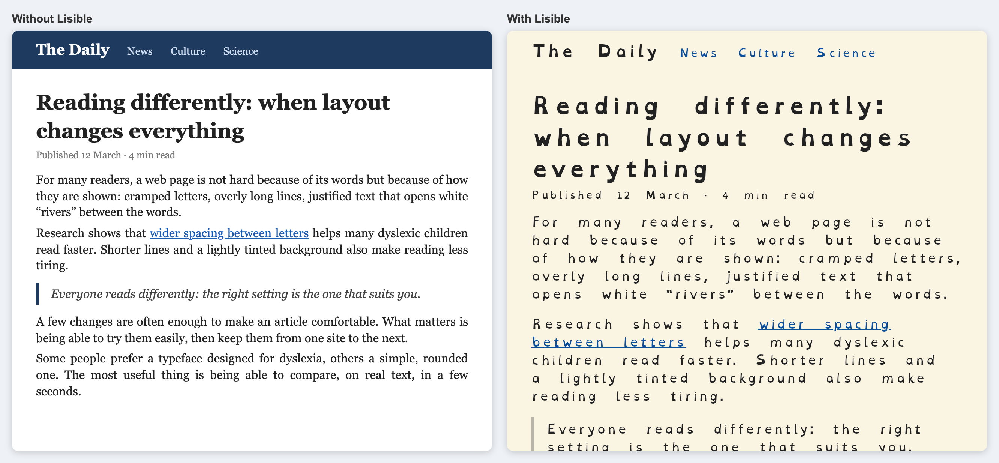
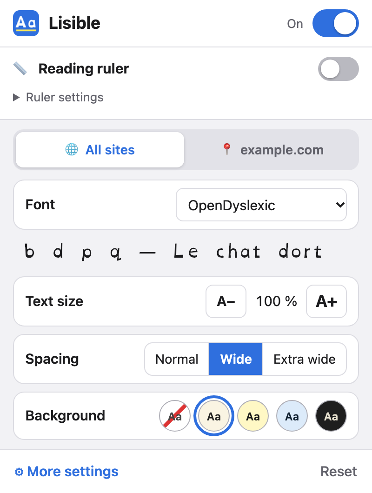
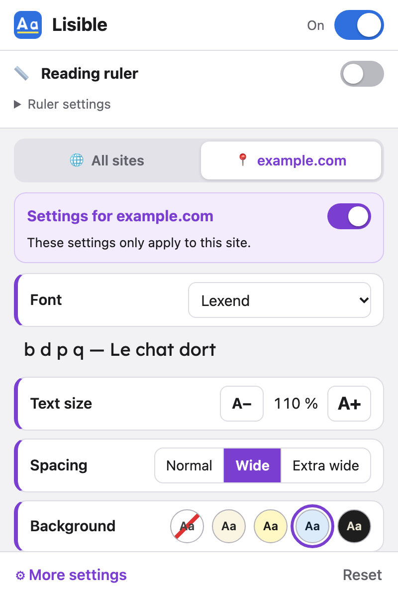
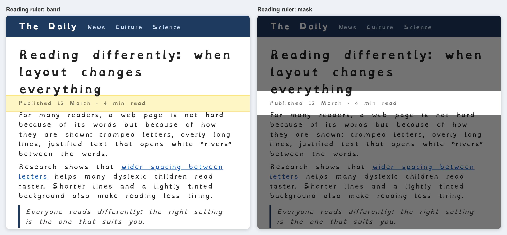

# Lisible

*English · [Français](README.fr.md)*

A browser extension for **Safari, Chrome, Edge and Firefox**, on **computers, tablets and phones**, that makes the web more comfortable to read for people with dyslexia: suitable fonts, spacing, colours and a reading ruler, with settings shared by all sites and per-site exceptions.


 
## Compatibility

| Device | Browsers | Build |
|---|---|---|
| Computer (macOS, Windows, Linux) | Chrome, Edge and other Chromium browsers | `dist/chrome` |
| | Firefox | `dist/firefox` |
| Mac | Safari | Xcode project |
| Android phone and tablet | Firefox for Android | `dist/firefox` |
| iPhone and iPad | Safari | Xcode project |

On iPhone and iPad, only Safari accepts extensions. On Android, Chrome does not accept any: Firefox is needed.

The Chrome build is tested automatically in Chromium, and the Firefox build is validated by Mozilla's official tool (`web-ext lint`). Edge, Firefox for Android and Safari have not yet been tried on a real device.

## Documentation

- [User guide](docs/en/user-guide.md): install, enable and adjust Lisible.
- [Developer guide](docs/en/developer-guide.md): architecture, adding a setting or a font, tests, building and publishing.

## Features

<p>
  
  
</p>



| | |
|---|---|
| **Bundled fonts** | OpenDyslexic, Atkinson Hyperlegible, Lexend, Andika (SIL OFL licence, embedded files that work offline) |
| **System fonts** | Verdana, Arial, or the site's own font |
| **Text** | size (80–200 %), letter thickness (normal / bold), alignment (left / centred / right / justified), case (lowercase / UPPERCASE / Capitalised), remove italics |
| **Spacing** | between letters, between words, line height, between paragraphs, maximum line length (in characters) |
| **Recommended values** | in one click: letters +0.12 em, words +0.42 em, line height 1.5, 70-character lines, cream background, no italics. These are approximate values from the British Dyslexia Association style guide; the chosen font is kept |
| **Colours** | cream, yellow, blue, green, pink, grey and dark themes, or custom colours (text, background, links) |
| **Links** | highlight (colour of your choice, black or white text depending on contrast), outline |
| **Reading ruler** | a coloured band, or a mask that dims the rest of the page; it follows the pointer, or your finger on phones and tablets. Shared by all sites, at the top of the popup |
| **Per site** | the site tab (in purple) in the popup: turn Lisible off for this site or give it its own settings; all special sites are listed in “More settings” |
| **Two levels** | a simple popup (font, size, Normal / Wide / Extra wide spacing, background) and a “More settings” page for every fine-grained setting |
| **Undo** | every change made in the popup can be undone |
| **Preview** | sample text showing the settings live (in “More settings”; in the popup, the page itself is the preview) |
| **Shortcuts (computer)** | `Alt+Shift+D` (`⌥⇧D` on Mac) turns Lisible on or off for the site, `Alt+Shift+R` (`⌥⇧R`) shows or hides the ruler |
| **Fonts in apps (iPhone, iPad)** | a configuration profile installs the four fonts system-wide, for Pages, Keynote, Mail, Word… (not needed for Safari, see the [user guide](docs/en/user-guide.md#7-fonts-in-other-apps-iphone-ipad)) |
| **Languages** | French and English |

Every option has an “unchanged” value that leaves the page as it is. Code, formulas, SVG and icon fonts (Font Awesome, Material Icons…) keep their original font.

## Quick start (developers)

```bash
npm run build                                          # dist/chrome, dist/firefox, dist/safari + zips, iOS font profile
npm test                                               # tests (Node 22, Playwright + Chromium)
npm run lint:firefox                                   # Mozilla validation of the Firefox build
./scripts/creer-projet-xcode.sh com.mydomain.lisible   # Safari: on a Mac with Xcode
```

Details are in the [developer guide](docs/en/developer-guide.md).

## Known limitations

- **Sync**: settings are not synchronised between Mac, iPhone and iPad. Safari syncs the list of installed extensions, not their data (to be checked again with each Safari version).
- **Shadow DOM**: content inside a closed *Shadow DOM* is not restyled.
- **Colour themes**: they make element backgrounds opaque, but not background images. Some very graphic sites may therefore stay hard to read.
- **Text size**: it uses `zoom` on `<body>`. On a few fixed layouts, elements may shift.
- **Blocked fonts (to be checked in Safari)**: some sites' content security policy (`font-src`) might block the embedded fonts. The fallback font (`sans-serif`) would then be shown.

## Sources

### Apps and extensions studied

- [Helperbird – best extensions for dyslexia](https://www.helperbird.com/blog/best-chrome-extensions-for-students-with-dyslexia/) and [How-To Geek – fonts and extensions for dyslexia](https://www.howtogeek.com/444235/fonts-and-browser-extensions-that-help-those-with-dyslexia-read-the-web/): text-to-speech, reading rulers, BeeLine.
- [AccessHelper (Firefox)](https://addons.mozilla.org/fr/firefox/addon/accesshelper/): read aloud, reader mode.
- [LireCouleur overview (Versailles education authority)](https://pedagogie92.ac-versailles.fr/wp-content/uploads/sites/451/2021/02/Focus_LireCouleur.pdf) (French): syllable colouring.

### Typography guidelines

- [Smashing Magazine – Adding a dyslexia-friendly mode to a website](https://smashingmagazine.com/2021/11/dyslexia-friendly-mode-website): summarises the British Dyslexia Association guide (2018) on letter and word spacing and line height. These are the values of the recommended preset.
- [Dyslexia Scotland – dyslexia-friendly formats](https://dyslexiascotland.org.uk/dyslexia-friendly-typed-formats): spacing, tinted pale backgrounds rather than pure white.

### Research

- [Anglia Ruskin University – extra spacing speeds up reading (Stagg et al., 2021)](https://www.aru.ac.uk/news/extra-spacing-can-boost-childrens-reading-speed): wider letter spacing speeds up reading for dyslexic children (about +13 %), with no effect from coloured overlays.
- [Royal Holloway – letter spacing and coloured overlays in adults](https://pure.royalholloway.ac.uk/en/publications/the-effect-of-letter-spacing-and-coloured-overlays-on-reading-spe): effects of spacing and coloured overlays on reading speed and accuracy in dyslexic adults.
- [Smithsonian – e-readers and short lines (Schneps et al., 2013)](https://dashboard.si.edu/newsdesk/releases/smithsonian-experts-find-e-readers-can-make-reading-easier-those-dyslexia): very short lines help some dyslexic readers, not all. This is where the line-length setting comes from.
- [DUMAS – thesis on syllable colouring](https://dumas.ccsd.cnrs.fr/dumas-03282114/document) (French): in dyslexic 7–8 year olds, colouring improves accuracy but not speed.
- [Wery & Diliberto – OpenDyslexic, reading rate and accuracy (2017)](https://www.ncbi.nlm.nih.gov/pmc/articles/PMC5629233/): no improvement in reading rate or accuracy with OpenDyslexic compared with Arial or Times.
- [The Conversation – Bionic Reading](https://theconversation.com/can-bionic-reading-make-you-a-speed-reader-not-so-fast-183905): no evidence that it works. That is why the feature is not included.

### Safari technical notes

- [lapcatsoftware – Safari extension storage](https://lapcatsoftware.com/articles/storage.html): `storage.sync` is not synchronised through iCloud (observed in 2021).
- [Gadget Hacks – sharing extensions across devices](https://ios.gadgethacks.com/how-to/safari-now-lets-you-sync-and-manage-all-your-web-extensions-across-your-iphone-ipad-and-mac-0385127/): installation is shared across devices, not data.

## Licence

The code is under the [PolyForm Noncommercial 1.0.0](LICENSE) licence: anyone may use, modify and redistribute it, but not for a commercial purpose (sale, subscription, advertising…). The fonts have their own licence (see below).

## Font licences

OpenDyslexic, Atkinson Hyperlegible, Lexend and Andika are distributed under the **SIL Open Font License 1.1** (see `extension/fonts/licenses/`). The files come from the npm packages `@fontsource/*` 5.3.0. The “More settings” page credits them under *About > Credits and licences*. The iPhone / iPad font profile uses the original, unmodified TTF / OTF files instead (see `assets/polices-ios/README.md`).

To be checked: OpenDyslexic has a Reserved Font Name. The Fontsource files are converted to WOFF2 and reduced to Latin characters; it remains to be confirmed that this is not a “Modified Version” under the licence, or the author's original files should be used.
