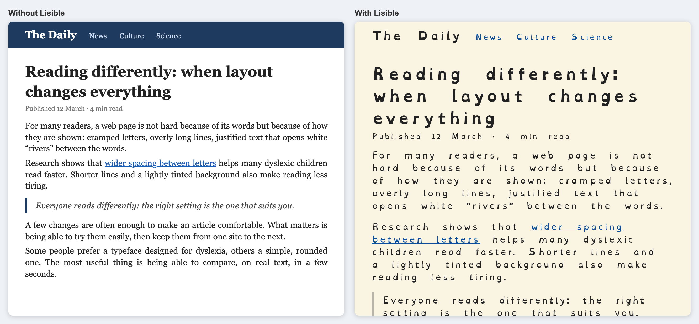
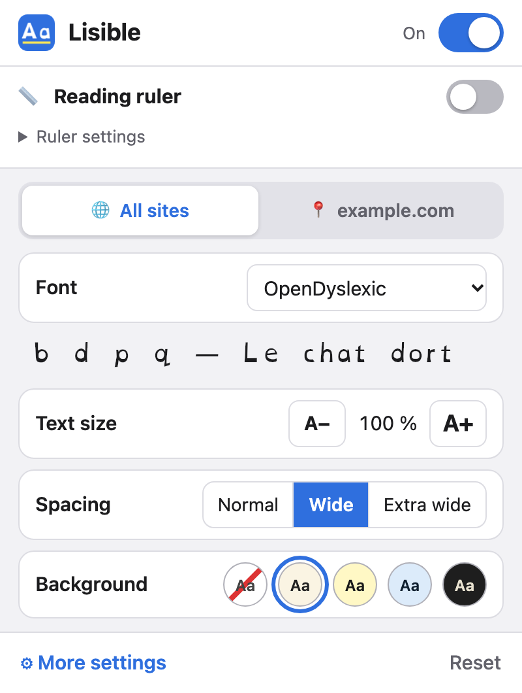
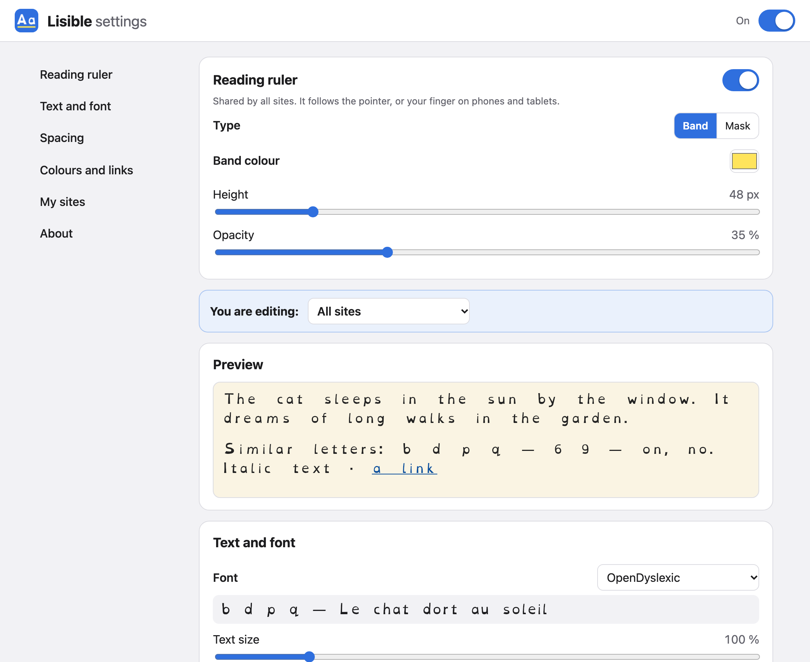
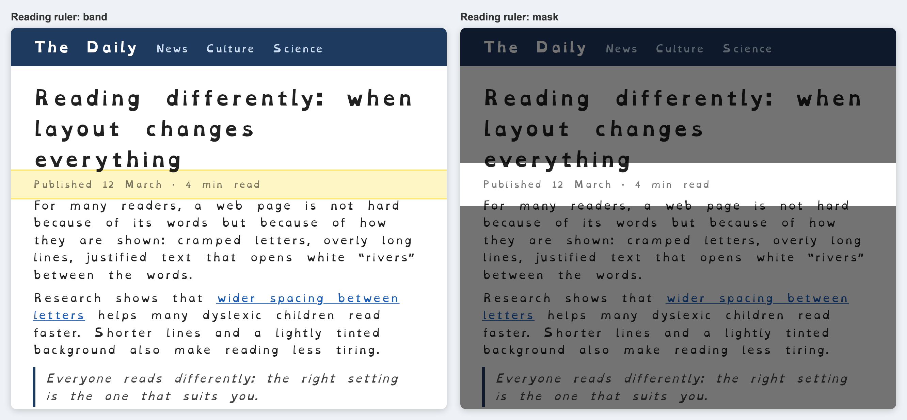
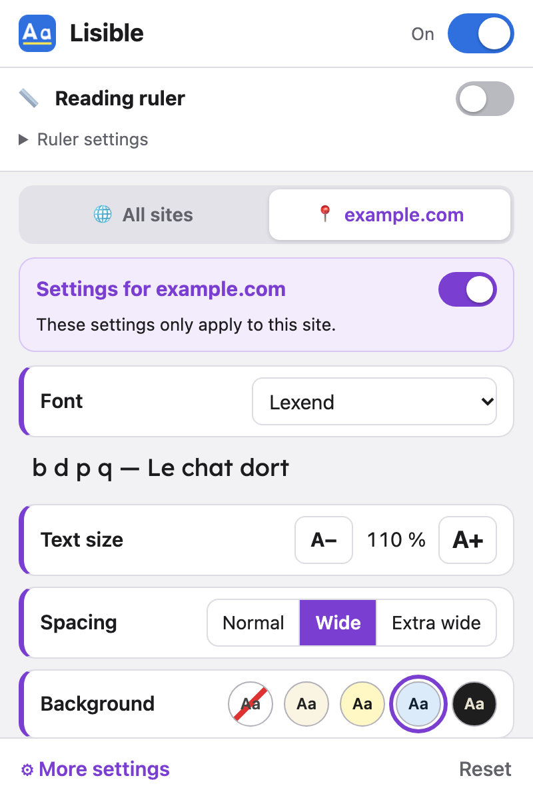
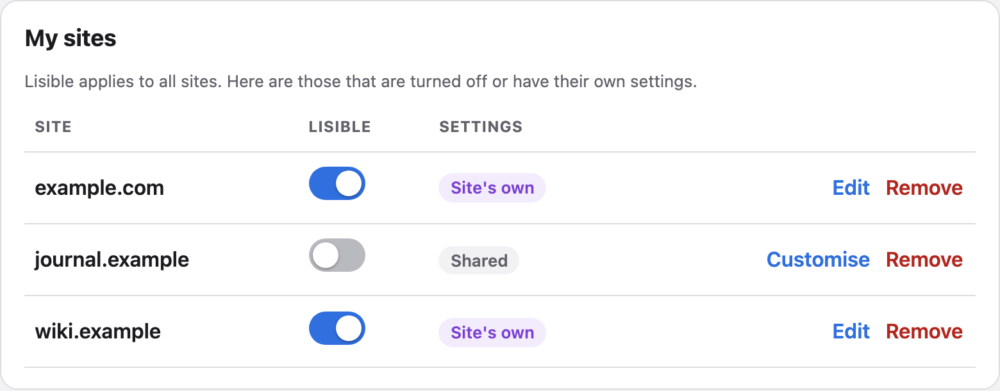

# User guide

*English · [Français](../fr/manuel-utilisateur.md)*

Lisible changes how web pages look to make them easier to read: font, spacing, colours and a reading ruler. Pages are not changed on the server, only how they are displayed for you.

## 1. Install and enable the extension

Lisible works with:
- **Safari** on Mac, iPhone and iPad;
- **Chrome, Edge and Firefox** on computers;
- **Firefox** on Android phones and tablets.

Chrome for Android, and Chrome and Firefox on iPhone, do not accept extensions.

> Until Lisible is published in the stores, it is installed in “developer mode” from the folders produced by `npm run build` (see the [developer guide](developer-guide.md)).

**Chrome / Edge (computer)**
1. Open `chrome://extensions` (or `edge://extensions`) and turn on **Developer mode**.
2. Click **Load unpacked** and choose the `dist/chrome` folder.
3. Pin Lisible: puzzle-piece icon, then the pin next to Lisible.

**Firefox (computer)**
1. Open `about:debugging`, then **This Firefox**.
2. Click **Load Temporary Add-on** and choose the `dist/firefox/manifest.json` file. The add-on stays installed until Firefox is closed.

**Safari on Mac**
1. Open the Lisible app once after installing it.
2. In Safari, open *Safari > Settings > Extensions* and tick **Lisible**.
3. Allow Lisible on “All Websites” so that it applies everywhere.

**On iPhone and iPad**
1. Open *Settings > Apps > Safari > Extensions* (on older iOS versions: *Settings > Safari > Extensions*).
2. Tap **Lisible**, turn it on and choose *Allow* for “All Websites”.

## 2. Open the settings

- **Computer**: click the Lisible **Aa** icon in the browser toolbar.
- **iPhone / iPad (Safari)**: tap the page menu button, on the left or right of the address bar depending on the iOS version, then **Lisible**.
- **Android (Firefox)**: menu **⋮**, then **Extensions**, then **Lisible**.

Changes apply straight away to the open page. After each change, an **Undo** button appears for a few seconds.

## 3. Settings

### The popup (simple settings)

From top to bottom:

1. **Header**: the main switch, which turns Lisible on or off everywhere.
2. **Reading ruler**: a switch to show it. Its settings (band or mask, colour, height, opacity) are folded under **Ruler settings**. The ruler is the same on all sites.
3. **Two tabs** to choose what you are changing:
   - **🌐 All sites**: the shared settings;
   - **📍 the open site** (in purple): the settings of this site only (see part 4).
4. **Simple settings**:
   - **Font**;
   - **Text size**, with the A− and A+ buttons;
   - **Spacing**: *Normal* (the site's own), *Wide* or *Extra wide*. It sets the space between letters, words, lines and paragraphs at once;
   - **Background**: site colours, cream, yellow, blue or dark.
5. **More settings** and **Reset** (two taps: *Reset*, then *Confirm?*).

### The “More settings” page

It opens in a tab and holds every fine-grained setting:

| Section | Settings |
|---|---|
| **Reading ruler** | show, band or mask, colour, height, opacity |
| **You are editing** | choose between the settings of all sites and those of a customised site (in purple) |
| **Preview** | sample text with the chosen settings |
| **Text and font** | font, size, letter thickness (normal or bold), alignment, upper / lower case, remove italics |
| **Spacing** | level (Normal / Wide / Extra wide), then fine-tuning: between letters, words, lines, paragraphs, maximum line length |
| **Colours and links** | 9 backgrounds (including custom colours for text, background and links), link highlight and outline |
| **My sites** | the list of sites that are turned off or customised, to edit or remove |
| **About** | version, keyboard shortcuts, credits and licences, *Reset everything* |

“Unchanged” or “site font / colours” means Lisible does not touch that setting.

**To get started**, choose *Extra wide* spacing in the popup, or the **Apply recommended values** button on the “More settings” page (wider spacing, 70-character lines, cream background, no italics). Then adjust to your liking: everyone reads differently.

### The reading ruler

It follows the mouse pointer, or your finger on phones and tablets. In *band* mode it highlights the line being read with a colour; in *mask* mode it darkens the rest of the page.

## 4. Per-site settings

Lisible applies to all sites. For a particular site, open the **📍 site tab** in the popup; it is purple so that it is never confused with the shared settings:

- **Lisible on this site**: untick to see this site as it is (useful for a site that displays badly).
- **Customise for this site**: creates settings for this site only, starting from a copy of the shared settings. Other sites are not affected.
- **Go back to the settings of all sites**: deletes the site's own settings.

When the open site has its own settings, the popup opens directly on its tab. All special sites are listed in **More settings > My sites**.

## 5. Keyboard shortcuts (computer)

| Shortcut | Action |
|---|---|
| `Alt` + `Shift` + `D` (Mac: `⌥ Option` + `⇧ Shift` + `D`) | turn Lisible on or off for the site |
| `Alt` + `Shift` + `R` (Mac: `⌥ Option` + `⇧ Shift` + `R`) | show or hide the reading ruler |

Each browser lets you change these shortcuts (Chrome: `chrome://extensions/shortcuts`; Firefox: *Add-ons > gear icon > Manage Extension Shortcuts*).

## 6. Troubleshooting

- **Nothing changes on the page**: check that Lisible is allowed on this site (Safari's *Settings > Extensions*) and that it is not turned off for this site (site tab in the popup). Reload the page.
- **A page displays badly**: turn Lisible off for this site, or customise this site and change the setting at fault (often the text size or the colour theme).
- **Icons turn into letters or squares**: choose *Site font* for this site.
- **My settings are not on my other device**: this is expected for now; each device keeps its own settings.
- **I made a mistake**: tap **Undo** right after the change.
- **Go back to the original settings**: tap **Reset** at the bottom of the popup, then **Confirm?** within 3 seconds. Only the settings of the open tab are reset. To erase everything, including sites: *More settings > About > Reset everything*.

## 7. Install the fonts for other apps (iPhone, iPad, Mac)

Lisible can also install its four fonts (OpenDyslexic, Atkinson Hyperlegible, Lexend and Andika) system-wide. You can then choose them in apps that let you change the font: Pages, Keynote, Numbers, Mail, Word, TextEdit…

> **Not needed to read the web.** The extension already brings its fonts to web pages, in Safari, Chrome and Firefox. This installation is only for other apps.

Everything is in a single file, the **font profile** `lisible-polices-<version>.mobileconfig`. It is made by `npm run build` in the `dist/` folder and works on iPhone, iPad and Mac.

### On iPhone and iPad

1. **Send the file to the device**, either:
   - by **AirDrop** from a Mac;
   - as an **email attachment**, opened in the Mail app;
   - by **downloading it in Safari** (Safari asks you to allow downloading a profile: tap *Allow*).
2. iOS shows **“Profile Downloaded”**. Tap *Close*.
3. Open the **Settings** app. Tap **Profile Downloaded**, just below your name.
   If that row is not there: *Settings > General > VPN & Device Management*, then the *Lisible – polices / fonts* profile.
4. Tap **Install** (top right), enter the device **passcode**, then tap **Install** twice more.
5. Tap **Done**. The fonts are listed in *Settings > General > Fonts*.

Good to know:
- **Do step 3 promptly**: a profile that is downloaded but not installed is deleted after a few minutes. Just start again from step 1.
- iOS says the profile is **“Unsigned”** or **“Not Verified”**: this is normal for a profile that does not come from a company or a store. It only contains fonts and gives no access to your data.
- On a managed device (school, company), installing profiles may be blocked: ask the administrator.

**Remove the fonts**: *Settings > General > VPN & Device Management*, tap *Lisible – polices / fonts*, then **Remove Profile**.

### On Mac

**With the profile** (a single file, handy for several Macs):
1. Double-click `lisible-polices-<version>.mobileconfig`. macOS says the profile has been downloaded.
2. Open **System Settings**:
   - macOS 15 and later: *General > Device Management*;
   - macOS 13 and 14: *Privacy & Security > Profiles* (at the very bottom);
   - macOS 12 and earlier: *System Preferences > Profiles*.
3. Double-click *Lisible – polices / fonts*, click **Install**, then enter the Mac's password.

To remove the fonts, select the profile in the same place and click **−** (Remove).

**Without the profile, with Font Book** (no warning, no trip to Settings):
1. Open the project's `assets/polices-ios/` folder, which holds the `.otf` and `.ttf` files.
2. Select them all, double-click, then click **Install** in Font Book.

To remove a font: in **Font Book**, select it, then *File > Remove*.

### Choose the font in an app

The fonts are called **OpenDyslexic**, **Atkinson Hyperlegible**, **Lexend** and **Andika** in font menus. For example:
- **Pages, Keynote, Numbers** (iPhone, iPad): select some text, tap the paintbrush, then the font name.
- **Pages, TextEdit, Word** (Mac): *Format > Font* menu, or the font list in the toolbar.

If a font does not show up, quit the app completely and open it again.

## 8. Credits and licences

In *More settings > About*, the **Credits and licences** section names the author of each bundled font. Tap a font's name to read its licence (SIL Open Font License 1.1).

## 9. Privacy

Lisible sends no data. Settings stay on your device, and the fonts are bundled with the extension (no downloads).
