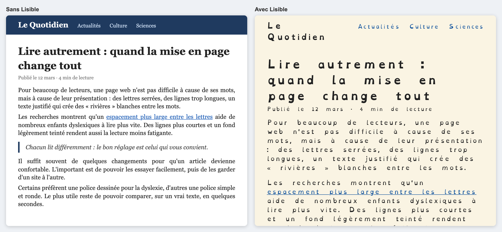
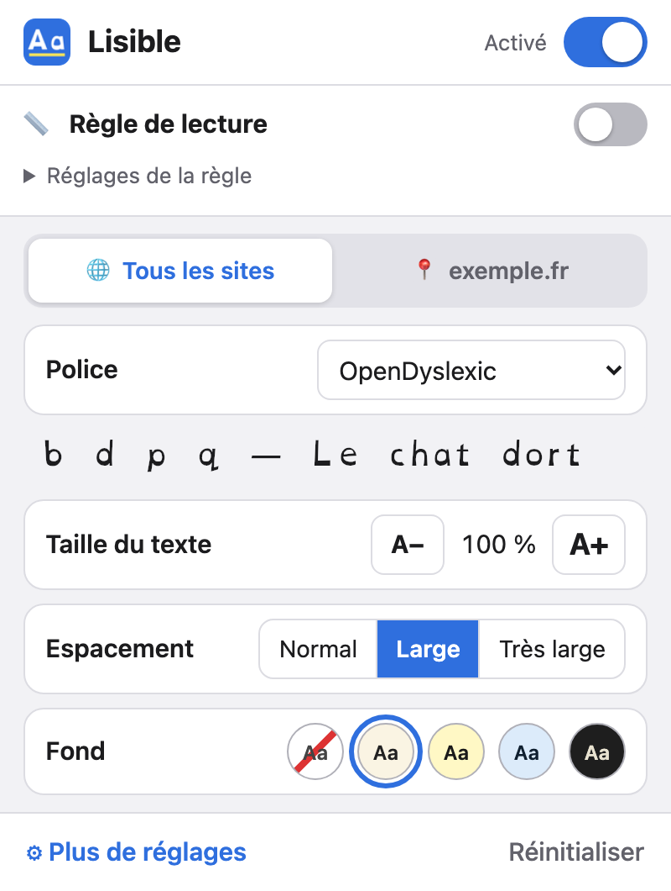
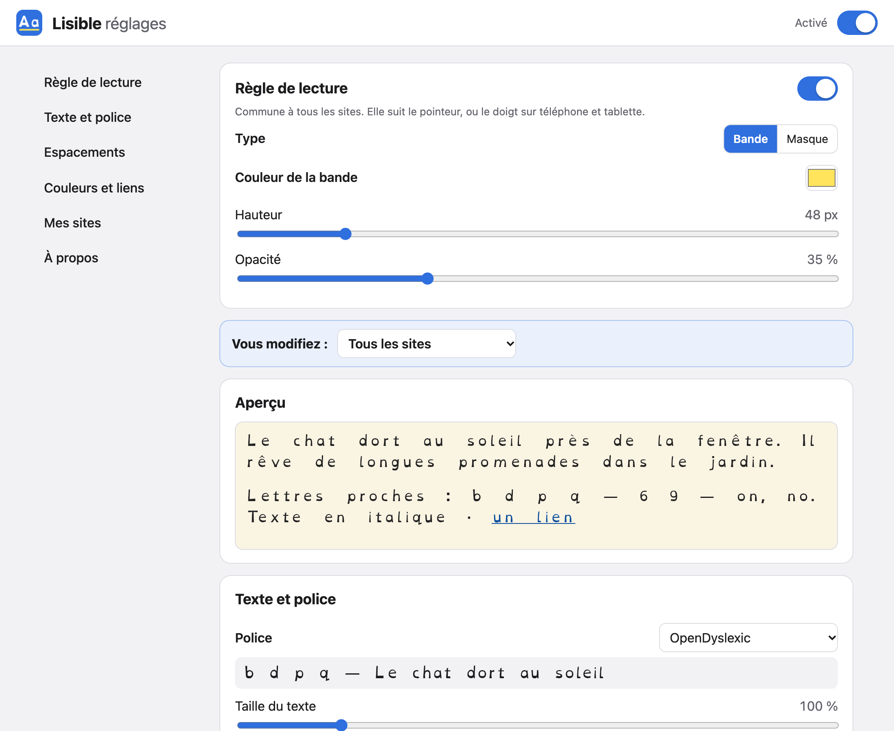
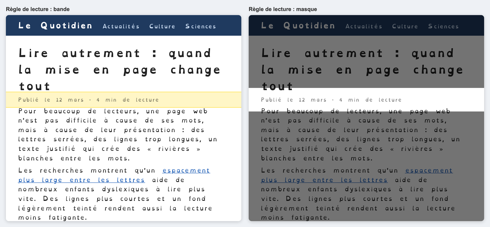
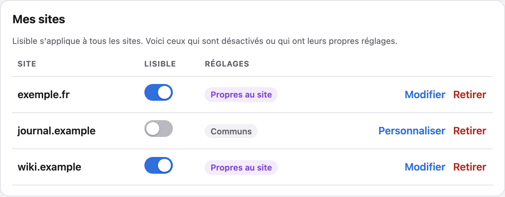

# Manuel utilisateur

*[English](../en/user-guide.md) · Français*

Lisible change l'apparence des pages web pour les rendre plus faciles à lire : police, espacements, couleurs et règle de lecture. Les pages ne sont pas modifiées sur le serveur, seulement leur affichage chez vous.

## 1. Installer et activer l'extension

Lisible fonctionne avec :
- **Safari** sur Mac, iPhone et iPad ;
- **Chrome, Edge et Firefox** sur ordinateur ;
- **Firefox** sur téléphone et tablette Android.

Chrome pour Android, ainsi que Chrome et Firefox sur iPhone, n'acceptent pas les extensions.

> Tant que Lisible n'est pas publiée dans les stores, l'installation se fait « en mode développeur » à partir des dossiers produits par `npm run build` (voir le [manuel développeur](manuel-developpeur.md)).

**Chrome / Edge (ordinateur)**
1. Ouvrez `chrome://extensions` (ou `edge://extensions`) et activez le **Mode développeur**.
2. Cliquez sur **Charger l'extension non empaquetée** et choisissez le dossier `dist/chrome`.
3. Épinglez Lisible : icône en forme de pièce de puzzle, puis l'épingle à côté de Lisible.

**Firefox (ordinateur)**
1. Ouvrez `about:debugging`, puis **Ce Firefox**.
2. Cliquez sur **Charger un module complémentaire temporaire** et choisissez le fichier `dist/firefox/manifest.json`. Le module reste installé jusqu'à la fermeture de Firefox.

**Safari sur Mac**
1. Ouvrez l'app Lisible une fois après l'installation.
2. Dans Safari, ouvrez *Safari > Réglages > Extensions* et cochez **Lisible**.
3. Autorisez Lisible sur « Tous les sites web » pour qu'elle s'applique partout.

**Sur iPhone et iPad**
1. Ouvrez *Réglages > Apps > Safari > Extensions* (sur les versions plus anciennes d'iOS : *Réglages > Safari > Extensions*).
2. Touchez **Lisible**, activez-la et choisissez *Autoriser* pour « Tous les sites web ».

## 2. Ouvrir les réglages

- **Ordinateur** : cliquez sur l'icône **Aa** de Lisible dans la barre d'outils du navigateur.
- **iPhone / iPad (Safari)** : touchez le bouton de menu de la page, à gauche ou à droite de la barre d'adresse selon la version d'iOS, puis **Lisible**.
- **Android (Firefox)** : menu **⋮**, puis **Extensions**, puis **Lisible**.

Les modifications s'appliquent tout de suite à la page ouverte. Après chaque changement, un bouton **Annuler** apparaît quelques secondes.

## 3. Les réglages

### La popup (réglages simples)

De haut en bas :

1. **En-tête** : l'interrupteur général, qui active ou désactive Lisible partout.
2. **Règle de lecture** : un interrupteur pour l'afficher. Ses réglages (bande ou masque, couleur, hauteur, opacité) sont repliés sous **Réglages de la règle**. La règle est la même sur tous les sites.
3. **Deux onglets** pour choisir ce que vous modifiez :
   - **🌐 Tous les sites** : les réglages communs ;
   - **📍 le site ouvert** (en violet) : les réglages de ce site seulement (voir la partie 4).
4. **Réglages simples** :
   - **Police** ;
   - **Taille du texte**, avec les boutons A− et A+ ;
   - **Espacement** : *Normal* (celui du site), *Large* ou *Très large*. Il règle d'un coup l'espace entre les lettres, les mots, les lignes et les paragraphes ;
   - **Fond** : couleurs du site, crème, jaune, bleu ou sombre.
5. **Plus de réglages** et **Réinitialiser** (deux appuis : *Réinitialiser*, puis *Confirmer ?*).

### La page « Plus de réglages »

Elle s'ouvre dans un onglet et contient tous les réglages fins :

| Section | Réglages |
|---|---|
| **Règle de lecture** | affichage, bande ou masque, couleur, hauteur, opacité |
| **Vous modifiez** | choisir entre les réglages de tous les sites et ceux d'un site personnalisé (en violet) |
| **Aperçu** | un texte d'exemple avec les réglages choisis |
| **Texte et police** | police, taille, épaisseur des lettres (normale ou grasse), alignement, majuscules / minuscules, suppression de l'italique |
| **Espacements** | niveau (Normal / Large / Très large), puis réglage fin : entre les lettres, les mots, les lignes, les paragraphes, longueur maximale des lignes |
| **Couleurs et liens** | 9 fonds (dont des couleurs personnalisées pour le texte, le fond et les liens), surlignage et encadrement des liens |
| **Mes sites** | la liste des sites désactivés ou personnalisés, à modifier ou retirer |
| **À propos** | version, raccourcis clavier, crédits et licences, *Tout réinitialiser* |

« Inchangé » ou « celle du site » signifie que Lisible ne touche pas à ce réglage.

**Pour bien démarrer**, choisissez l'espacement *Très large* dans la popup, ou le bouton **Appliquer les valeurs conseillées** de la page « Plus de réglages » (espacements élargis, lignes de 70 caractères, fond crème, sans italique). Ajustez ensuite à votre goût : chacun lit différemment.

### La règle de lecture

Elle suit le pointeur de la souris, ou le doigt sur téléphone et tablette. En mode *bande*, elle colore la ligne lue ; en mode *masque*, elle assombrit le reste de la page.

## 4. Réglages par site

Lisible s'applique à tous les sites. Pour un site particulier, ouvrez l'onglet **📍 du site** dans la popup ; il est en violet pour qu'on ne le confonde pas avec les réglages communs :

- **Lisible sur ce site** : décochez pour voir ce site tel quel (utile pour un site qui s'affiche mal).
- **Personnaliser pour ce site** : crée des réglages propres à ce site, en partant d'une copie des réglages communs. Ils ne changent rien aux autres sites.
- **Revenir aux réglages de tous les sites** : supprime les réglages propres du site.

Quand le site ouvert a ses propres réglages, la popup s'ouvre directement sur son onglet. Tous les sites particuliers sont listés dans **Plus de réglages > Mes sites**.

## 5. Raccourcis clavier (ordinateur)

| Raccourci | Action |
|---|---|
| `Alt` + `Maj` + `D` (Mac : `⌥ Option` + `⇧ Maj` + `D`) | activer ou désactiver Lisible sur le site |
| `Alt` + `Maj` + `R` (Mac : `⌥ Option` + `⇧ Maj` + `R`) | afficher ou masquer la règle de lecture |

Chaque navigateur permet de changer ces raccourcis (Chrome : `chrome://extensions/shortcuts` ; Firefox : *Modules complémentaires > roue dentée > Gérer les raccourcis*).

## 6. En cas de problème

- **Rien ne change sur la page** : vérifiez que Lisible est autorisée sur ce site (*Réglages > Extensions* de Safari) et qu'elle n'est pas désactivée pour ce site (onglet du site dans la popup). Rechargez la page.
- **Une page s'affiche mal** : désactivez Lisible sur ce site, ou personnalisez ce site et changez le réglage en cause (souvent la taille du texte ou le thème de couleur).
- **Des icônes deviennent des lettres ou des carrés** : choisissez *Police du site* pour ce site.
- **Mes réglages ne sont pas sur mon autre appareil** : c'est normal pour l'instant, chaque appareil garde ses propres réglages.
- **Je me suis trompé** : touchez **Annuler** juste après le changement.
- **Revenir aux réglages d'origine** : touchez **Réinitialiser** en bas de la popup, puis **Confirmer ?** dans les 3 secondes. Seuls les réglages de l'onglet ouvert sont réinitialisés. Pour tout effacer, y compris les sites : *Plus de réglages > À propos > Tout réinitialiser*.

## 7. Installer les polices dans les autres apps (iPhone, iPad, Mac)

Lisible peut aussi installer ses quatre polices (OpenDyslexic, Atkinson Hyperlegible, Lexend et Andika) dans le système. Vous pouvez alors les choisir dans les apps qui permettent de changer de police : Pages, Keynote, Numbers, Mail, Word, TextEdit…

> **Inutile pour lire le web.** L'extension apporte déjà ses polices aux pages, dans Safari, Chrome et Firefox. Cette installation ne sert que pour les autres apps.

Tout se trouve dans un seul fichier, le **profil de polices** `lisible-polices-<version>.mobileconfig`. Il est produit par `npm run build` dans le dossier `dist/` et fonctionne sur iPhone, iPad et Mac.

### Sur iPhone et iPad

1. **Envoyez le fichier sur l'appareil**, au choix :
   - par **AirDrop** depuis un Mac ;
   - en **pièce jointe d'un e-mail**, ouverte dans l'app Mail ;
   - en le **téléchargeant dans Safari** (Safari demande d'autoriser le téléchargement d'un profil : touchez *Autoriser*).
2. iOS affiche **« Profil téléchargé »**. Touchez *Fermer*.
3. Ouvrez l'app **Réglages**. Touchez **Profil téléchargé**, juste sous votre nom.
   Si cette ligne n'apparaît pas : *Réglages > Général > VPN et gestion de l'appareil*, puis le profil *Lisible – polices / fonts*.
4. Touchez **Installer** (en haut à droite), saisissez le **code** de l'appareil, puis touchez encore **Installer** deux fois.
5. Touchez **OK**. Les polices sont listées dans *Réglages > Général > Polices*.

À savoir :
- **Faites l'étape 3 rapidement** : un profil téléchargé mais pas installé est effacé au bout de quelques minutes. Il suffit alors de recommencer à l'étape 1.
- iOS indique que le profil est **« Non signé »** ou **« Non vérifié »** : c'est normal pour un profil qui ne vient pas d'une entreprise ou d'un store. Il ne contient que des polices et ne donne aucun accès à vos données.
- Sur un appareil géré (école, entreprise), l'installation de profils peut être bloquée : demandez à l'administrateur.

**Retirer les polices** : *Réglages > Général > VPN et gestion de l'appareil*, touchez *Lisible – polices / fonts*, puis **Supprimer le profil**.

### Sur Mac

**Avec le profil** (un seul fichier, pratique pour plusieurs Mac) :
1. Double-cliquez sur `lisible-polices-<version>.mobileconfig`. macOS indique que le profil a été téléchargé.
2. Ouvrez **Réglages Système** :
   - macOS 15 et plus : *Général > Gestion des appareils* ;
   - macOS 13 et 14 : *Confidentialité et sécurité > Profils* (tout en bas) ;
   - macOS 12 et avant : *Préférences Système > Profils*.
3. Double-cliquez sur *Lisible – polices / fonts*, cliquez sur **Installer**, puis saisissez le mot de passe du Mac.

Pour retirer les polices, sélectionnez le profil au même endroit et cliquez sur **−** (Supprimer).

**Sans profil, avec le Livre des polices** (pas d'avertissement, pas de passage par les Réglages) :
1. Ouvrez le dossier `assets/polices-ios/` du projet, qui contient les fichiers `.otf` et `.ttf`.
2. Sélectionnez-les tous, double-cliquez, puis cliquez sur **Installer** dans le Livre des polices.

Pour retirer une police : dans le **Livre des polices**, sélectionnez-la, puis *Fichier > Supprimer*.

### Choisir la police dans une app

Les polices s'appellent **OpenDyslexic**, **Atkinson Hyperlegible**, **Lexend** et **Andika** dans les menus de police. Par exemple :
- **Pages, Keynote, Numbers** (iPhone, iPad) : sélectionnez du texte, touchez le pinceau, puis le nom de la police.
- **Pages, TextEdit, Word** (Mac) : menu *Format > Police*, ou la liste des polices de la barre d'outils.

Si une police n'apparaît pas, quittez complètement l'app et rouvrez-la.

## 8. Crédits et licences

Dans *Plus de réglages > À propos*, la rubrique **Crédits et licences** indique l'auteur de chaque police incluse. Touchez le nom d'une police pour lire sa licence (SIL Open Font License 1.1).

## 9. Confidentialité

Lisible n'envoie aucune donnée. Les réglages restent sur votre appareil, et les polices sont incluses dans l'extension (aucun téléchargement).
